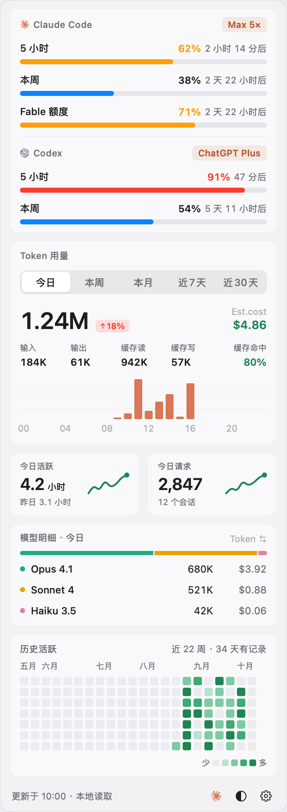
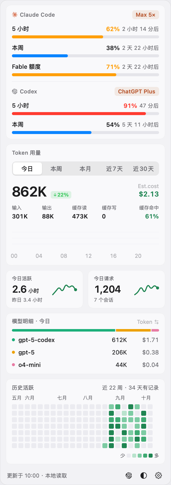
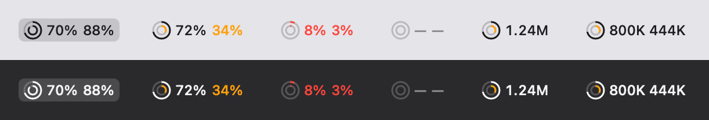
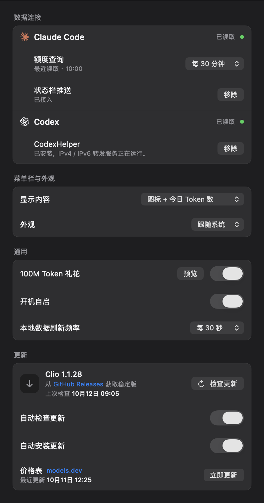

# Clio

Clio 是面向 Claude Code 和 Codex 用户的 macOS 菜单栏用量工具。它将本机会话记录整理为额度、Token 用量、费用估算和活跃度视图，帮助你了解当前使用情况及近期变化。

Clio 的名字取自希腊神话中掌管历史的缪斯克利俄（Clio），寓意记录与回顾。应用将日常使用记录整理为可查看的用量历史，让每一次使用都有迹可循。

无需导入日志或另建用量账号。启动后，Clio 自动读取本机已有记录；点击菜单栏图标即可查看面板。

  
  

主面板截图使用示例数据，展示额度、今日用量、活跃度、模型明细和历史活跃分布。

## 安装与开始使用

**系统要求：** Apple Silicon Mac，macOS 14 或更高版本。当前安装包不支持 Intel Mac。

1. 从 [GitHub Releases](https://github.com/UreMySunshine/clio/releases) 下载 `Clio-<版本>.dmg`。
2. 打开安装包，将 Clio 拖入「应用程序」并启动。
3. 点击菜单栏中的 Clio 图标查看数据。应用不显示程序坞图标。
4. 如果尚无记录，先使用一次 Claude Code 或 Codex，再在面板中刷新。

当前分发安装包未经过 Apple 开发者签名与公证。首次启动若被系统阻止，可在「系统设置 → 隐私与安全性」中检查 Clio 的阻止提示，选择「仍要打开」并确认。

## 查看订阅额度

面板顶部按 Claude Code、Codex 的顺序展示工具名称、套餐和额度窗口。可用窗口包括 5 小时、本周及按模型划分的额度，具体内容取决于工具提供的数据。

- **百分比表示已使用额度。** 数值越高，剩余额度越少。
- **右侧时间表示距离重置的时间。** 已到重置时间的窗口显示「已重置」。
- 利用率达到 60% 时显示橙色，达到 80% 时显示红色。
- 悬停进度条可查看按当前速率推算的耗尽时间；预计重置前不会耗尽时，提示会直接说明。

额度百分比来自工具报告的订阅数据。尚未获取百分比时，Clio 展示可统计的窗口内 Token 数，不显示百分比进度条。Claude Code 的 5 小时窗口重置后，无新用量时显示 0%；有新用量但未收到新额度数据时，先显示该窗口的 Token 数。

额度数据有更新时间限制，尤其是 Codex：没有新请求时，日志中的额度快照可能保持不变。额度百分比和本地 Token 用量是两种独立统计，不能相互换算。

## 查看用量与趋势

### 选择统计范围

底栏的用量按钮依次切换「合并 → Claude → Codex」。合并状态显示叠层图标，单工具状态显示对应工具图标；只有一个工具有记录时，按钮隐藏。

范围切换会同时影响用量、今日活跃、今日请求、模型明细和历史活跃。订阅额度与菜单栏始终展示两个工具的数据，已选择的统计周期保持不变。

  
  

左侧为 Claude Code 用量，右侧为 Codex 用量，均使用示例数据。

### 选择统计周期

| 周期 | 统计范围 | 柱状图分组 |
| --- | --- | --- |
| 今日 | 本地时间当天 | 小时 |
| 本周 | 从本周一开始 | 星期 |
| 本月 | 当前自然月 | 日期 |
| 近7天 | 包含今天的最近 7 个自然日 | 日期 |
| 近30天 | 包含今天的最近 30 个自然日 | 日期 |

用量卡片显示所选周期的 Token 总量、相对上一周期的变化、费用估算，以及输入、输出、缓存读、缓存写和缓存命中率。柱状图展示周期内的使用分布；合并范围中，Claude Code 为橙色，Codex 为蓝色。

悬停柱状图可查看对应时段的数据。合并范围下，悬停总量、费用、分项数值或活跃度，可查看各工具的贡献。

### 模型明细与费用

模型明细完整列出所选周期内的模型、Token 数及估算费用。右上角可切换按 Token 或花费排序，占比条随之切换；模型颜色在周期和排序切换时保持一致。

`Est.cost` 为按模型公开调用单价计算的费用估算，以美元显示，**不代表订阅账单或实际扣款**。缺少模型价格时，该模型及包含它的总费用显示「—」，Token 统计仍可查看。价格表来自 [models.dev](https://models.dev)，每 24 小时检查一次；网络校验失败时沿用上次结果。

Codex 的缓存量属于输入量的一部分，推理量属于输出量的一部分，不会重复计入总量。日志报告的总量可能与可用分项之和不同。

## 查看活跃度

| 指标 | 含义 |
| --- | --- |
| 今日活跃 | 根据回复时间间隔估算的活跃时长，附昨日数值及近期趋势 |
| 今日请求 | 当天回复条数，附去重后的会话数及近期趋势 |
| 历史活跃 | 近 22 周的每日 Token 分布，颜色深浅表示用量高低 |

活跃时长按相邻回复的间隔累计，每段最多计 5 分钟；合并范围中，同时使用两个工具的时间不重复累计。该指标是估算值，不等同于应用运行时长或实际工作时长。

两张今日卡片展示最近 14 天的趋势。悬停历史活跃中的日期格，可查看当天用量；合并范围下也可查看各工具的数值。今日卡片和历史活跃不随用量统计周期切换，只随工具范围切换。

## 菜单栏显示

在「设置 → 菜单栏与外观 → 显示内容」中选择常驻菜单栏的信息。

| 显示方式 | 展示内容 |
| --- | --- |
| 仅图标 | Clio 图标 |
| 图标 + 今日 Token 数 | 两个工具合计的今日 Token 数 |
| 双环 + 百分比 | 两个工具各自的每周剩余额度 |
| 双环 + Token（合并显示） | 额度双环与合计的今日 Token 数 |
| 双环 + Token（分开显示） | 额度双环与各工具的今日 Token 数 |

双环的外圈表示 Claude Code，内圈表示 Codex；数字也按这一顺序排列。**菜单栏双环表示每周剩余额度，主面板进度条表示已使用额度。** 剩余 20%～50% 时显示橙色，低于 20% 时显示红色；未获取额度时显示「—」。悬停可查看工具名称、5 小时剩余额度和每周重置时间。

## 设置

  
  

设置分为四组：

| 分组 | 可配置内容 |
| --- | --- |
| 数据连接 | 数据读取状态、Claude Code 额度查询频率、状态栏推送、CodexHelper |
| 菜单栏与外观 | 菜单栏显示内容、跟随系统／浅色／深色外观 |
| 通用 | Token 里程碑礼花、开机自启、本地数据刷新频率 |
| 更新 | 应用更新、自动检查与安装、价格表更新 |

底栏外观按钮也可依次切换跟随系统、浅色、深色。macOS 26 及以上使用液态玻璃呈现面板与设置窗口。开机自启是否可用取决于应用签名与系统注册结果。

### Claude Code 额度连接

Clio 默认读取 Claude Code 本地缓存，并通过已登录的 Claude Code 主动查询额度。打开面板时查询一次，后台默认每 30 分钟查询一次，可在设置中调整频率。查询不消耗 Token，也不产生新会话记录。

如需在使用 Claude Code 时更及时地同步额度，可选择「状态栏推送 → 接入」。Clio 会备份状态栏配置，保留原有命令，并在状态栏刷新时接收额度数据；选择「移除」可还原配置。此通道不提供按模型划分的额度。

### CodexHelper

CodexHelper 是可选的本机连接辅助服务，用于通过正在运行的本机代理转发 Codex 后台连接。它不负责统计 Token；Codex 用量与额度仍从会话日志读取。

| 状态 | 可用操作 |
| --- | --- |
| 未安装 | 安装 |
| 已安装且正常运行 | 移除 |
| 已安装，但配置不完整或服务未运行 | 修复、移除 |
| 内置辅助程序版本更高，或检测到可迁移的旧式服务 | 更新、移除 |

更新按辅助程序独立版本判断，同版本重新构建 Clio 不会触发更新提示。执行安装、修复、更新或移除期间，设置会显示进度和结果。

使用前需要可用的本机 HTTP 与 SOCKS5 代理、系统 Python 及空闲的本机 443 端口。安装需管理员授权，会修改 Codex 的代理配置和系统域名映射，并注册开机运行的后台服务。域名映射对同机访问该域名的其他程序也生效。

辅助服务仅监听本机地址，通过代理转发至固定的 Codex 后台域名，透传加密连接，不读取登录凭据。安装前会备份配置；失败时尝试恢复本次修改，恢复失败的项目会显示在结果中。

安装完成后，请重新启动 Codex 并检查工作空间能否加载。Clio 的连接验证不代表 Codex 登录及初始化一定成功。移除时停止服务、删除受管理的域名映射，并恢复由 Clio 修改的代理配置；用户后来修改的配置会保留。

### 应用更新

Clio 在启动时及每 24 小时检查 GitHub Releases。启用「自动安装更新」时，新版本在后台下载，并在面板与设置窗口均关闭后安装和重启。安装完成后，首次打开面板会显示版本提示。

关闭自动安装后，可通过更新提示进入设置手动安装。关闭自动检查后，也停止自动安装。应用所在目录不可写时，不执行自动安装。

### 里程碑礼花

两个工具合计的日、周或月用量每突破 100M Token 时，Clio 展示约 5 秒的全屏礼花。礼花不阻挡鼠标操作，可在「设置 → 通用」中预览或关闭。

## 数据与隐私

Clio 读取本机 Claude Code、Codex 的现存会话日志，支持压缩及归档记录，并对重复记录去重。它不修改会话日志，也不将用量数据上传到服务器。

- Claude Code 数据目录：`~/.claude/projects`。
- Codex 数据目录：`~/.codex/sessions`、`~/.codex/archived_sessions`。
- 本地刷新重新读取日志，应用不另存一份用量账本。删除日志后，对应记录不再计入统计。
- 价格表查询连接 models.dev；应用更新查询和下载连接 GitHub；额度查询由 Claude Code 执行。
- 接入状态栏推送及安装 CodexHelper 会修改相应配置，这些操作由设置中的按钮触发。

## 常见问题

**为什么没有用量数据？**

确认这台 Mac 上已有 Claude Code 或 Codex 会话记录。在工具中完成一次请求后，通过面板底栏的齿轮菜单选择「刷新」。

**为什么额度没有更新，或只显示 Token 数？**

额度依赖工具提供的快照。Codex 通常在新请求后更新；Claude Code 可通过主动查询及状态栏推送刷新。尚未收到百分比时，Clio 显示可统计的 Token 数。

**为什么费用显示「—」？**

所选周期中包含尚无价格的模型，无法计算完整费用。可以在设置中更新价格表，Token 统计不受影响。

**为什么统计与账单或其他工具不同？**

Clio 只统计本机现存日志，不包含其他设备、已删除记录或服务器端账单数据。费用使用公开调用单价估算，活跃时长依据回复时间估算。

**为什么 CodexHelper 没有「修复」按钮？**

只有识别到已安装但未就绪的服务时才显示「修复」。正常运行时只显示「移除」；存在辅助程序新版本或旧式服务迁移时，优先显示「更新」。

## 开发与构建

本地构建、签名、测试和截图生成方式见 [开发说明](docs/development.md)。
