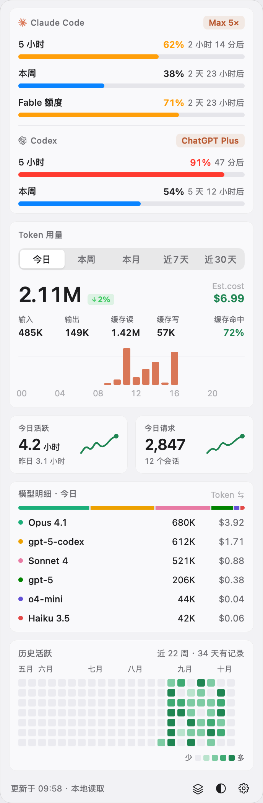
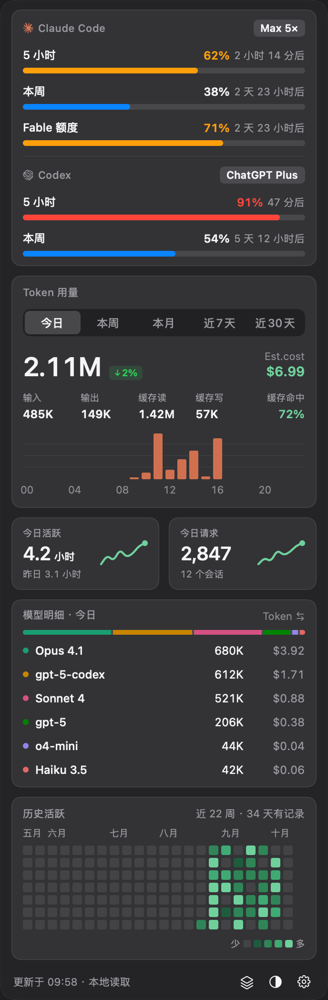
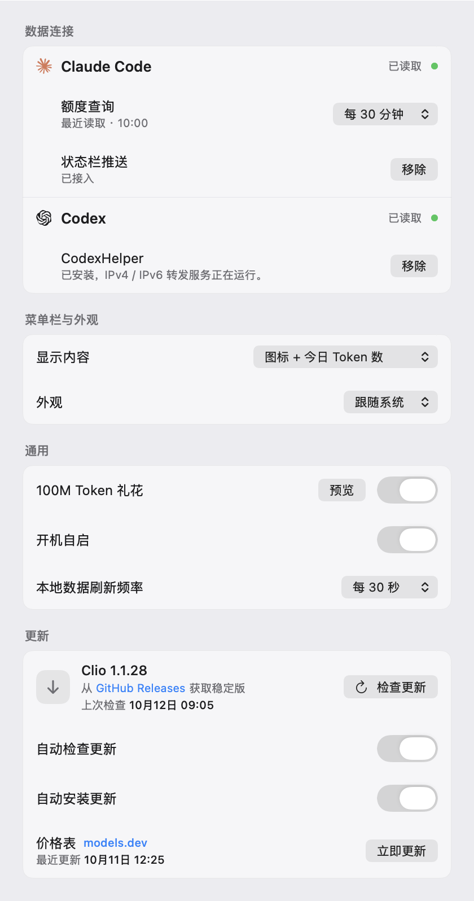

# Clio

macOS 菜单栏里的 Claude Code / Codex 用量面板：额度还剩多少、今天烧了多少 Token、花了多少钱，点一下菜单栏就能看到。

名字取自记述历史的缪斯克利俄——这个工具做的就是把本地会话日志读成一本账。

<p align="center">
  
  
</p>

## 功能

### 额度

- **5 小时**、**本周**、**按模型**（如 Fable）三个窗口的真实利用率与重置时间。
- 订阅卡片依次列出 Claude Code 与 Codex 的额度，每个账号以名称与套餐开头。
- Claude Code 的 5 小时窗口重置后，没有新请求时显示 0% 和空进度条；有新用量但尚未收到百分比时，只统计重置后新窗口内的 Token，收到新额度后恢复百分比。
- 利用率超过六成转橙、超过八成转红。
- 悬停进度条给出按当前速率的耗尽推算，例如「按当前速率约 1 小时 40 分后耗尽」；在重置前用不完时直说用不完，不给一个比重置时间还远的数字。
- 百分比背后对应多少 Token 从不推断——日志里被拒绝的窗口区间在 53M 到 206M 之间，不是一个固定值。

### 用量

- Claude Code 与 Codex 合计的 Token 总量、环比、花费估算，周期通过带滑块动画的分段控件切换：今日 / 本周 / 本月 / 近7天 / 近30天。本周从周一开始，本月按自然月统计；近7天、近30天包含今天，分别按本地时区最近 7 个、30 个自然日统计。
- 日志计数按本机 ccusage 20.0.26 的源码核对：Claude 使用消息 ID 与请求 ID 去重，流式更新保留完整用量，回放优先保留主会话；Codex 优先读取最新请求增量，缺失时取累计字段的非负差值，缓存包含在输入中，推理包含在输出中，均不重复加总。Codex 总量保留日志报告的 `total_tokens`，即使它与可用分项之和不同。按每条用量事件的时间筛选周期。
- 输入、输出、缓存读、缓存写与缓存命中率，均为两个工具合计。
- Token 总量、花费与这五项在悬停时显示各工具的数值，数值为 0 的工具不列出；热力图与活跃度卡片的悬停提示同样如此。
- Codex 的输入总量包含缓存读和缓存写，三项分别显示且不重复计入总量；缓存写取日志中的 `cache_write_input_tokens`，字段缺失时记为 0。
- 柱状图按小时（今日）、按星期（本周）、按日期（其它周期）分布，两个工具按颜色堆叠，Claude Code 在下、Codex 在上；悬停显示该柱的合计与各工具的数值。最近周期也按完整自然日分组。
- 按模型的占比条与逐行明细，两个工具的模型合并后全部列出，含各自的 Token 与花费。每个模型固定一个颜色，切换周期或 Token / 花费时不变。
- 花费按公开 API 单价估算。模型价格缺失时，模型花费与包含该模型的总花费估算显示「—」；Token 数仍正常统计。Codex 的自动审查（`codex-auto-review`）按 0 计价：通过 ChatGPT 账号使用时免费且不计入套餐额度，见 [OpenAI 官方说明](https://help.openai.com/en/articles/11369540-using-codex-with-your-chatgpt-plan)。

### 活跃度

- **今日活跃**：两个工具的回复按时间合并后，相邻两次回复的间隔求和，每段最多计 5 分钟，同时使用两个工具的时段只计一次；副行是昨日同口径。
- **今日请求**：今天两个工具的回复条数与去重后的会话数之和。
- 两张卡片各带一条最近 14 天的折线，悬停显示各工具的数值。
- **每日活跃**热力图，近 22 周，按两个工具可用日志的合计着色，悬停显示某天的日期、合计与各工具的用量。

### 菜单栏

<p align="center"></p>

菜单栏固定展示两个工具的数据，可选择「仅图标」「图标 + 今日 Token 数」「双环 + 百分比」「双环 + Token（合并显示）」「双环 + Token（分开显示）」。带图标或合并显示的今日 Token 数是 Claude Code 与 Codex 的合计。

「双环 + 百分比」的外圈为 Claude Code、内圈为 Codex，后方数字依次为 Claude Code、Codex，环长和数字均表示每周剩余额度。余量大于50%使用菜单栏文字色，20%～50%为橙色，低于20%为红色，未获取到额度时显示「—」。悬停显示工具名称、五小时剩余额度及每周重置时间。

「双环 + Token」的两个选项沿用相同的额度双环和悬停提示。「合并显示」显示两个工具合计的今日 Token 数；「分开显示」依次显示 Claude Code、Codex 各自的今日 Token 数，使用 K/M 单位且不显示小数。

### 里程碑礼花

<p align="center"></p>

按 Claude Code 与 Codex 的合计，日、周或月累计每突破 100M Token 时全屏庆祝，约 5 秒后自动消失，透明且可点穿，不打断手上的操作。设置里可预览、可关闭。

### 其它

- 外观：底栏的外观按钮每点一次切换一档，依次为跟随系统、浅色、深色。
- macOS 26 及以上始终使用液态玻璃显示面板与设置窗口。
- 价格表取自 [models.dev](https://models.dev)，每 24 小时用 ETag 条件请求校验一次，失败时沿用上次结果。
- 自动更新：启动时与每 24 小时查询一次 GitHub Releases。发现新版本后在后台下载安装包，弹出层与设置窗口都关闭时替换当前应用并重启，之后第一次打开面板时底栏提示「已更新到 x.y.z」。设置里关闭「自动安装更新」后只提示新版本，点「更新」才安装；关闭「自动检查更新」则两者都停止。应用所在目录不可写时不自动安装。

## 额度数据从哪来

<p align="center"></p>

三条途径，可同时生效。主动查询的结果经配置缓存读入；合并时比较配置缓存与状态栏推送，取较新的一份。

**读配置缓存**（默认，无需配置，最省）。Claude Code 在运行时会把额度写进 `~/.claude.json` 的 `cachedUsageUtilization`，带 `fetchedAtMs` 时间戳，通常只落后一两分钟。读一个 JSON 文件不起任何进程，所以它是首选来源。

**主动查询**（默认，无需配置）。向 Claude Code 发一条 `get_usage` 控制请求：

```
claude --print --verbose --input-format stream-json --output-format stream-json
{"type":"control_request","request_id":"clio","request":{"subtype":"get_usage","skip_behaviors":true}}
```

用已有的登录，不消耗 Token，不写会话记录。展开面板时问一次，其余按设置里的查询频率（默认 30 分钟）。Claude Code 长时间没运行时，配置缓存会变旧，这条路负责补上。

Claude Code 应答前会把取到的额度连同获取时间写进 `~/.claude.json`，Clio 从那里读回，不直接采用应答：应答本身不带获取时间，距上次获取不到 60 秒或接口请求失败时，应答的是缓存里最长 1 小时前的值。

需要注意的是，Claude Code 把这个请求标为实验性，响应结构可能变化。真变了的话额度会退回只显示窗口内的 Token 数，其余功能不受影响。

**状态栏推送**（可选）。设置里按一下「接入」，把 `~/.claude/settings.json` 的 `statusLine.command` 改写成：

```
"/Applications/Clio.app/Contents/MacOS/Clio" --statusline -- <原有 statusLine 命令>
```

原命令原样保留在后面，状态栏照常渲染。此后 Claude Code 每渲染一次状态栏就推送一次额度，用它时几乎实时。改写前会备份成 `settings.json.bak-clio-<时间戳>`，按「移除」可还原。这条通道不含按模型窗口。

**Codex 额度**（默认，无需配置）。Codex 把额度写在会话日志的 `token_count` 事件里，字段是 `rate_limits`。`window_minutes` 为 10080（7 天）的窗口用 `used_percent` 和 `resets_at` 显示在「本周」；这是上一轮请求附带的快照，没有新的请求就不会更新。订阅记录未提供 5 小时窗口时，面板隐藏该行。套餐标识 `prolite` 显示为「Pro 5×」。额度百分比与本地 Token 累计分别统计。

## CodexHelper

设置的「数据连接」中，Codex 下的 CodexHelper 子条目只显示状态和一个按钮：未安装时显示「安装」，安装后显示「移除」。执行期间显示进度及管理员授权提示，结果或失败原因显示在状态位置。打开设置及每次安装前重新读取系统 HTTP 与 SOCKS5 代理地址和端口，缺失时读取已验证的 `~/.codex/.env` 本机代理，不预设端口。代理须已运行，支持无需认证的本机连接；安装前会验证两个代理端口可连接，检测失败时停止安装并显示原因。

安装需要管理员权限、可用的系统 `/usr/bin/python3` 及本机 443 端口，执行以下操作：

- 合并 `~/.codex/.env` 中的 `HTTP_PROXY`、`HTTPS_PROXY`、`ALL_PROXY` 和 `NO_PROXY`，保留其他键与注释，文件权限设为 0600。HTTP/HTTPS 使用 HTTP 代理，ALL_PROXY 使用由代理解析域名的 SOCKS5。
- 备份 `/etc/hosts` 到 `/Library/Application Support/CodexBackendRelay/hosts.before-<时间戳>`，仅维护 `BEGIN/END Codex backend relay` 标记内的 IPv4 与 IPv6 映射，刷新系统解析缓存。标记外已有同域名映射时停止安装。
- 注册 `local.codex.backend-relay` 系统后台服务，开机启动并持续运行。进程名称为 `CodexHelper`，可执行文件安装在 `/Library/Application Support/CodexBackendRelay/CodexHelper`，为 root:wheel、0755；服务配置为 root:wheel、0644，服务目录为 0755。仅监听 `127.0.0.1:443` 与 `[::1]:443`，通过本机 SOCKS5 的域名连接固定转发至 `codex-cloud-backend.chatgpt.com:443`，透传加密字节。系统 Python 仅用于安装、移除和状态检测，不作为常驻转发进程。

本机 TCP 443 端口必须可用；其他程序监听相同地址或通配地址的 443 端口时可能冲突，安装会停止并恢复本次修改。其他端口的监听不受影响。代理端口是转发程序连接的上游端口，由代理工具提供，CodexHelper 不监听这些端口。已安装的 Python 转发实例仍可识别和移除；使用新构建移除后重新安装，进程才会切换为 CodexHelper。

域名映射对同机其他程序也生效。安装不修改 Codex 应用包、全局代理环境或代理工具的增强模式，不安装新运行时。已识别且配置一致的运行实例不会重复安装或申请管理员权限；并发安装受系统文件锁保护。安装失败时恢复本次修改的配置、权限及已有服务，恢复失败会在结果中列出。

安装完成会分别验证 IPv4/IPv6 的加密连接及证书；这不能证明 Codex 登录和后台初始化成功。通过原应用图标重新启动 Codex，检查工作空间能否加载。Clio 不读取登录凭据，也不自动重启 Codex。最近一次操作结果保存在 Clio 支持目录的 `codex-helper-result.txt`。

「移除」停止并删除转发服务，删除 hosts 中的 Codex 标记块，恢复由 Clio 改写的环境变量，并刷新解析缓存。安装后新增的 hosts 内容及用户后来修改的环境变量会保留。安装前的环境变量备份和安装记录仅供管理员读取；移除成功后删除这两份文件，hosts 备份继续保留。对没有 Clio 安装记录的手动安装实例，移除服务和 hosts 映射，保留手动设置的 `.env`。移除失败时恢复原服务与配置。

开发验证：`bash Scripts/test-codex-helper.sh`，使用临时文件和随机本机端口，不操作系统安装实例。

SwiftPM 开发构建需同时构建 Clio 与 CodexHelper 两个可执行目标；`swift build` 默认构建两者。应用打包使用 `Scripts/build.sh`，将原生转发程序编译并签名后放入应用资源目录。

## 数据与隐私

- 只读本地日志：`~/.claude/projects`、`~/.codex/sessions` 与 `~/.codex/archived_sessions` 中的 `.jsonl` 和 `.jsonl.zst`，从不写入这些数据源。Zstandard 解码器随应用打包，无需安装额外工具。压缩或归档后的会话仍计入用量，压缩前后及活动、归档日志中的重复记录只计一次。
- 不保存用量账本：刷新时读取原始数据源，不再读写 Clio 旧版的每日用量 JSON 文件；已有文件保留在原处。日志删除或替换后会重建内存统计，确保刷新与重启结果一致。
- 应用向 models.dev 取价格表，向 GitHub 查询与下载新版本。额度请求是 Claude Code 自己发的。CodexHelper 安装时会验证 Codex 后台的加密连接，安装后由常驻服务转发该域名的流量。
- 用量数据不离开本机。

## 安装

从 [Releases](https://github.com/UreMySunshine/clio/releases) 下载最新的 `Clio-<版本>.dmg`，打开后把 Clio 拖进「应用程序」。应用不占用程序坞，启动后只在菜单栏出现。

只提供 Apple Silicon 版本，Intel Mac 上打不开。

安装包没有 Apple 开发者签名与公证，在别人的 Mac 上首次打开会被 Gatekeeper 拦下，提示「Apple 无法验证 "Clio" 是否包含可能危害 Mac 安全或泄漏隐私的恶意软件」。三种放行方式任选其一：

**一、系统设置里放行**

1. 双击 Clio，在提示框上点「完成」。
2. 打开「系统设置 → 隐私与安全性」，向下滚到「安全性」一节。
3. 那里会出现一行「已阻止使用 "Clio"…」，点「仍要打开」，再确认一次。

macOS 15 起旧版的「右键 → 打开」已经不能绕过，只能走这条。

**二、命令行摘掉隔离标记**

```bash
xattr -dr com.apple.quarantine /Applications/Clio.app
```

隔离标记是浏览器一类的下载工具加上的，摘掉后直接双击即可。

**三、自己构建**

本地构建出来的 app 不带隔离标记，不会有任何提示：

```bash
git clone https://github.com/UreMySunshine/clio.git
cd clio && Scripts/build.sh && cp -R build/Clio.app /Applications/
```

### 让提示彻底消失

需要 Apple Developer Program 账号。有了之后：

```bash
export CLIO_SIGN_IDENTITY="Developer ID Application: 你的名字 (TEAMID)"
xcrun notarytool store-credentials clio --apple-id <邮箱> --team-id <TEAMID> --password <应用专用密码>
export CLIO_NOTARY_PROFILE=clio
Scripts/package.sh
```

`build.sh` 会改用 Developer ID 签名并启用加固运行时，`package.sh` 会把 dmg 提交公证并装订票据，此后别人下载打开不再有任何提示。两个环境变量都不设时退回 ad-hoc 签名，行为与现在一致。

## 构建

```bash
Scripts/build.sh      # 出 build/Clio.app
Scripts/package.sh    # 出 build/Clio-<版本>.dmg
bash Scripts/test-usage-periods.sh  # 校验自然日周期和合并统计
bash Scripts/test-usage.sh # 用量解析与聚合回归验证
bash Scripts/test-quota-ring.sh # 校验内圈实际渲染的额度比例
bash Scripts/test-ccusage-alignment.sh # ccusage 日志去重、累计差值与周一边界验证
```

编译走 `swiftc` 直接调用而不是 `swift build`：只装了 Command Line Tools 的机器上，SwiftPM 的清单编译会失败。`Package.swift` 保留给装有完整 Xcode 的机器。

两个开发入口，用来在不点菜单栏的情况下检查读取与排版：

```bash
Clio --dump             # 把解析出的仪表盘打印成文本
Clio --snapshot <目录>   # 把每个界面渲染成 PNG
Clio --snapshot <目录> --menubar-only # 仅渲染菜单栏样式
```

## 已知限制

- Token 统计与本机 ccusage 20.0.26 的日志口径对齐：只统计现存日志，不补入数据库累计值，也不保存用量账本；已删除的日志不计入。
- 今日活跃是推算值：日志只记录每次回复的时间点，没有会话时长。
- 「开机自启」需要正式签名，ad-hoc 构建下注册会失败，开关会自己弹回关闭。
- 自动更新只核对 GitHub 给出的 SHA-256 摘要、包标识与版本号，没有开发者签名可供校验：安装包的可信程度等同于这个 GitHub 仓库本身。
